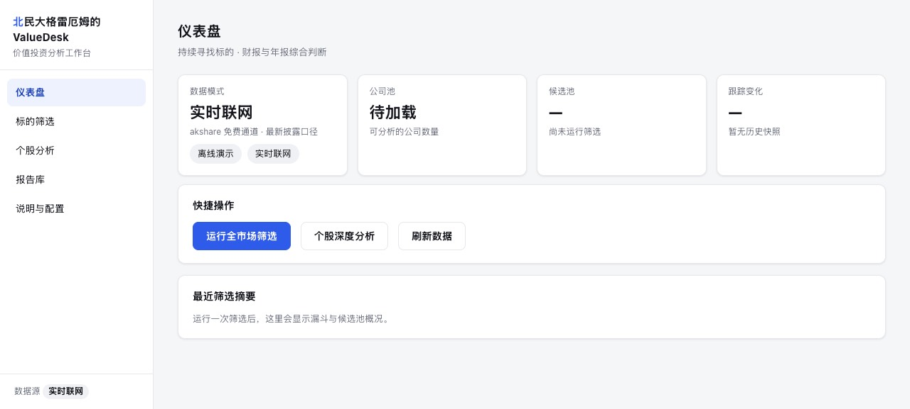
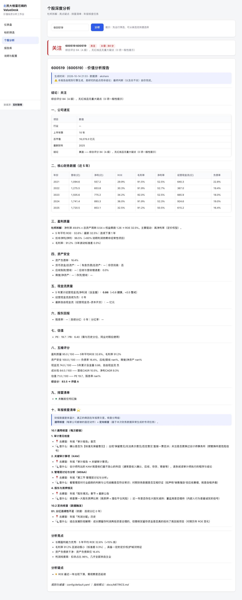

<div align="center">

# 北民大格雷厄姆的 ValueDesk

**价值投资分析工作台 · 持续寻找标的 + 财报与年报综合判断**

不是技术分析，不预测价格 —— 只回答两个问题：
**哪些公司值得进入研究清单？这家公司值不值得买？**

[](https://codespaces.new/ds1828743190-oss/nmu-graham-desk)
[](https://github.com/ds1828743190-oss/nmu-graham-desk/archive/refs/heads/main.zip)
[](LICENSE)

</div>



---

## 这是什么

一套**本地优先**的价值投资研究工作台：把"筛选 → 财报分析 → 年报核查"的工作流工程化为可运行的系统。
所有输出都是研究的起点，不是结论；最终判断和买卖决策永远由人完成。

| 能力 | 说明 |
|---|---|
| **五层筛选漏斗** | 硬性初筛 → 盈利质量（ROE）→ 排雷 → 估值 → 五维评分，每层淘汰都有据可查 |
| **财务排雷引擎** | 12 条红旗规则（存贷双高 / 利润含金量 / 应收异常 / 商誉 / 高杠杆…），红灯剔除、黄灯标注 |
| **五维评分** | 盈利质量 / 资产安全 / 现金流 / 成长 / 估值 加权打分 → A/B/C/D 评级，每一分可追溯 |
| **个股深度分析** | 杜邦拆解、亮点/疑点自动生成、三级结论（关注 / 观察 / 回避） |
| **年报核查清单** | 财报只是体温计 —— 每个异常自动映射到**年报的具体章节与核查动作**，让读年报变成定向核查 |
| **候选池持续跟踪** | 每次筛选留快照，自动对比变化（新进入 / 退出 / 评分变动） |
| **图形界面** | 本地 Web 界面（仪表盘 / 筛选 / 分析 / 报告库），零额外依赖（Python 标准库实现） |

## 🚀 快速开始（三种方式，任选其一）

### 方式一：云端一键打开（无需安装任何东西）

1. 点击顶部 **「🚀 一键打开 · Open in Codespaces」** 按钮（需要登录 GitHub 账号，免费额度足够使用）
2. 云端环境打开后，在终端执行：

```bash
pip install -r requirements.txt -i https://pypi.tuna.tsinghua.edu.cn/simple
python app/server.py --no-browser
```

3. 在底部 **PORTS** 面板找到 `8787` 端口 → 右键 **Port Visibility → Public** → 点击地球图标打开 —— 你就能看到完整界面（内置演示数据，开箱即用）。

### 方式二：本地运行 · macOS 双击启动

```bash
git clone https://github.com/ds1828743190-oss/nmu-graham-desk.git
```

下载后（或 ZIP 解压后）：**双击项目里的 `启动ValueDesk.command`** —— 自动检查环境 → 启动本地服务 → 打开浏览器界面。关闭终端窗口即停止。

### 方式三：本地运行 · 通用命令行（macOS / Linux / Windows）

```bash
git clone https://github.com/ds1828743190-oss/nmu-graham-desk.git
cd nmu-graham-desk
pip install -r requirements.txt -i https://pypi.tuna.tsinghua.edu.cn/simple
python app/server.py
```

浏览器会自动打开 `http://127.0.0.1:8787`。传统命令行入口也可用：

```bash
python tests/test_core.py               # 跑测试（7 项守护测试，含排雷样本）
python scripts/screen.py                # 全市场筛选 → reports/screen_*.md
python scripts/analyze.py 600519        # 个股深度分析 → reports/company_*.md
```

## 🖥️ 界面预览

<br>

**个股分析**：输入代码（约 3 秒）→ 结论卡 + 完整报告（杜邦拆解 / 五维评分 / 排雷清单 / 年报核查任务）



## 📊 两种数据模式（界面上一键切换）

| 模式 | 数据 | 速度 | 用途 |
|---|---|---|---|
| **离线演示**（默认） | 内置 30 家演示公司（含五类埋雷样本） | 筛选 1–2 秒 | 熟悉系统、测试排雷逻辑 |
| **实时联网** | akshare 免费通道：全市场年报数据 + 百度估值 | 筛选约 1–2 分钟；个股分析约 3 秒 | 日常使用 —— 数据为最新披露口径，**无需维护本地数据库** |

> 实时联网模式实测：约 80 秒扫完全 A股 11,000+ 家公司（5 年年报数据），
> 个股实时分析约 2.5–3 秒（含最新财务摘要与实时估值）。

## 📂 项目结构

```
nmu-graham-desk/
├── 启动ValueDesk.command    ← macOS 双击启动器
├── README.md                ← 你在这里
├── docs/
│   ├── METRICS.md           ← 指标手册：关注什么、阈值多少、为什么
│   ├── ARCHITECTURE.md      ← 架构说明：模块接口与依赖关系
│   └── images/              ← 界面截图
├── app/                     ← 图形界面层（本地服务 + 单页界面）
│   ├── server.py            ← 统一 API（/api/screen /api/analyze ...）
│   ├── ui.py                ← 单页界面（零外部资源）
│   └── render.py            ← Markdown → HTML 渲染
├── config/
│   └── default.yaml         ← 全部筛选阈值 / 排雷规则 / 评分权重
├── src/vd/                  ← 核心逻辑层
│   ├── data.py              ← 数据层（mock 含埋雷样本 / akshare 实时联网）
│   ├── metrics.py           ← 指标计算（三表 → 派生指标）
│   ├── screening.py         ← 筛选漏斗 + 排雷引擎
│   ├── scoring.py           ← 五维打分 → A/B/C/D
│   ├── analysis.py          ← 个股分析 + 年报核查清单生成
│   ├── report.py            ← 报告呈现（Markdown）
│   └── journal.py           ← 候选池跟踪（快照对比）
├── scripts/                 ← 命令行入口（screen / analyze）
├── tests/test_core.py       ← 测试套件（7 项守护测试）
└── reports/                 ← 输出（示例报告 / 跟踪快照）
```

## ⚙️ 关键配置（`config/default.yaml`）

| 参数 | 默认 | 含义 |
|---|---|---|
| `data.source` | mock | 数据模式：mock 离线演示 / akshare 实时联网 |
| `screen.min_roe_latest` | 8% | 最近一年 ROE 下限 |
| `screen.min_roe_5y_avg` | 10% | 近 5 年平均 ROE 下限 |
| `vetting.ocf_profit_ratio_red` | 0.5 | 利润含金量红灯线（5 年累计现金流 ÷ 净利） |
| `vetting.debt_ratio_warn` | 70% | 资产负债率黄旗线 |
| `vetting.goodwill_ratio_warn` | 30% | 商誉 ÷ 净资产 黄旗线 |
| `scoring.weights` | 30/20/20/15/15 | 五维评分权重（质量/安全/现金流/成长/估值） |

全部阈值可在界面切换或在配置文件中调整；每条排雷规则的数值依据见 [`docs/METRICS.md`](docs/METRICS.md)。

## ⚠️ 边界与免责声明

- 本工具的定位是**研究的起点**：它做规则化的事实整理与风险扫描，判断与决策必须由人完成；
- 不提供任何投资建议；数据来源于公开免费接口（akshare / 百度股市通 / 新浪财经），可能存在延迟或口径差异，**请以交易所公告与年报原文为准**；
- 离线演示模式的数据为模拟生成，仅用于验证系统逻辑，其结论不能外推到真实市场；
- 投资有风险，闲钱投资，仓位自控。

## 📄 License

[MIT](LICENSE) © 2026 ds1828743190-oss

---

<div align="center"><i>「价格是你付出的，价值是你得到的。」—— 本杰明·格雷厄姆</i></div>
